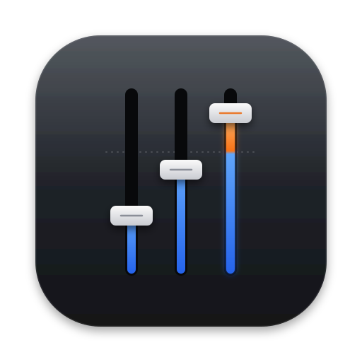
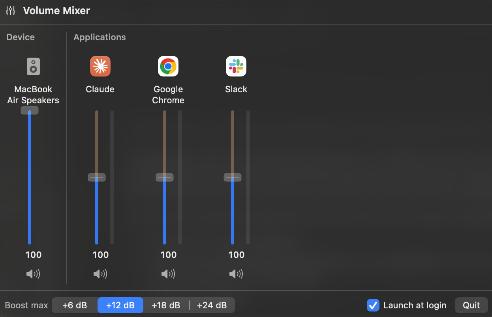

<p align="center">
  
</p>

<h1 align="center">AudioMixer</h1>

<p align="center">
  Per-app volume control for macOS, inspired by the Windows Volume Mixer.<br>
  Lives in the menu bar. Turn any app down — or boost it up to <b>+24 dB</b>.
</p>

<p align="center">
  <a href="https://github.com/Zahorrr/AudioMixer/releases/latest"></a>
  
  
  
</p>

<p align="center">
  
</p>

macOS has one volume slider for everything. When a video call is too quiet next to your music, or a browser tab is
blasting while you work, your only option is to turn *everything* up or down.

AudioMixer gives every app its own fader, like the Volume Mixer on Windows. Lower Slack notifications, push a quiet
call above 100 %, mute a game while keeping your music — straight from the menu bar.

## Contents

- [Install](#install)
- [Features](#features)
- [Uninstall](#uninstall)
- [Troubleshooting](#troubleshooting)
- [How it works](#how-it-works)
- [Build from source](#build-from-source)
- [Related projects](#related-projects)

## Install

Paste this in Terminal:

```bash
curl -fsSL https://raw.githubusercontent.com/Zahorrr/AudioMixer/main/install.sh | bash
```

It downloads the latest release, installs it in `/Applications` and launches it. Look for the sliders icon in your
menu bar.

Prefer a regular installer? Download **AudioMixer.pkg** from the
[latest release](https://github.com/Zahorrr/AudioMixer/releases/latest). It isn't signed with a paid Apple Developer ID,
so macOS will warn you the first time — see [Troubleshooting](#apple-could-not-verify-audiomixer).

**Requirements:** macOS 14.2 or later, Apple Silicon or Intel.

## Features

### A volume for every app

Each app that uses audio gets its own vertical fader with a live level meter, and a mute button underneath. The
**Device** column on the left controls your speakers or headphones as a whole. Double-click a value to snap back to 100.

### Boost beyond 100 %

Above the 100 mark, the fader turns orange and amplifies the app — up to +6, +12, +18 or +24 dB, your choice. A soft
limiter rounds off the peaks so boosted audio stays clean instead of crackling.

### A clean list

Apps are shown the way you know them. Chrome's, Claude's or Safari's background audio processes are grouped under the
app itself, and system processes stay out of the way. Right-click any column to reset it or hide the app; bring it
back later from Settings.

### Set it and forget it

Your levels are remembered per app and applied again as soon as the app plays sound — even after a restart.
AudioMixer launches at login by default. Apps you leave at 100 are never touched, so they get zero added latency.

### Settings

Open them from the ⚙️ in the mixer, a right click on the menu bar icon, or <kbd>⌘</kbd> <kbd>,</kbd>:

- Language — English or Français
- Launch at login
- Maximum boost
- Hidden apps, with a **Show** button for each

## Uninstall

1. Right-click the menu bar icon and choose **Quit**.
2. Move **AudioMixer** from `/Applications` to the Trash.

To remove everything, including your saved levels:

```bash
osascript -e 'quit app "AudioMixer"'
sudo rm -rf /Applications/AudioMixer.app
defaults delete io.github.zahorrr.AudioMixer
sudo pkgutil --forget io.github.zahorrr.AudioMixer
```

You can also remove it from *System Settings › Privacy & Security › Screen & System Audio Recording* and
*System Settings › General › Login Items*.

## Troubleshooting

### An app goes silent when I move its fader

AudioMixer needs permission to capture audio from other apps. Open
*System Settings › Privacy & Security › Screen & System Audio Recording* and turn **AudioMixer** on. After an update,
macOS may ask again.

### "Apple could not verify AudioMixer…"

macOS shows this for any downloaded app that isn't notarized by Apple. Open **System Settings › Privacy & Security**,
scroll down and click **Open Anyway** — or remove the quarantine flag before opening the installer:

```bash
xattr -d com.apple.quarantine ~/Downloads/AudioMixer.pkg
```

The `curl` install doesn't trigger this warning.

### The menu bar icon disappears after I click it

That's your menu bar manager (Ice, Bartender, Hidden Bar…) hiding it again. Move AudioMixer to its **always visible**
section, or hold <kbd>⌘</kbd> and drag the icon to the right of the manager's divider.

### An app isn't in the list

Apps only appear while they have audio open. If it still doesn't show up, check **Settings › Hidden apps**.

### Known limitations

- Audio is played on the **default output device**. An app that sends its sound to another device isn't controlled.
- Each app is mixed down to stereo, on the first two channels of the output.

## How it works

No kernel extension, no virtual audio driver. AudioMixer uses the **Core Audio process taps** API introduced in
macOS 14.2:

1. A `CATapDescription` with `muteBehavior = .mutedWhenTapped` captures an app's audio and silences it at the source.
2. A private aggregate device combines the current output device with that tap.
3. An IOProc applies the gain (smoothed per buffer, soft-clipped near 0 dBFS) and plays the result back.

When an app sits at 100 % and is playing, an *unmuted* tap only feeds the level meter — the audio itself is left alone.

## Build from source

Requires the Xcode Command Line Tools (`xcode-select --install`).

```bash
git clone https://github.com/Zahorrr/AudioMixer.git
cd AudioMixer
scripts/build.sh install   # build for this Mac, install in /Applications, launch
scripts/build.sh pkg       # universal build + dist/AudioMixer.pkg
```

| File | Role |
|---|---|
| `Sources/AppTap.swift` | Process tap + aggregate device + real-time render (gain, limiter, peak meter) |
| `Sources/MixerModel.swift` | App discovery & filtering, per-app state, tap lifecycle, persistence, language |
| `Sources/MixerView.swift` | SwiftUI mixer: vertical faders, meters, mute buttons |
| `Sources/SettingsView.swift` | Settings: language, launch at login, boost, hidden apps |
| `Sources/CoreAudioHelpers.swift` | Core Audio property helpers, process → app resolution |
| `Sources/AudioMixerApp.swift` | Menu bar item, popover, right-click menu, settings window |
| `Resources/` | `Info.plist` and app icon |
| `scripts/` | `swiftc` build, ad-hoc signing, install, `.pkg` packaging |

## Related projects

- [BackgroundMusic](https://github.com/kyleneideck/BackgroundMusic) — free and open source, the project that inspired
  this one. Per-app volume through a virtual audio driver, plus auto-pausing your music player.

## License

MIT — see [LICENSE](LICENSE).
